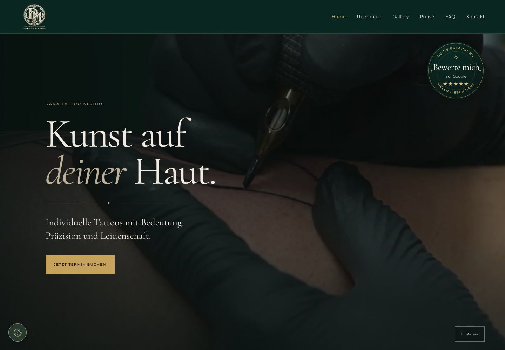
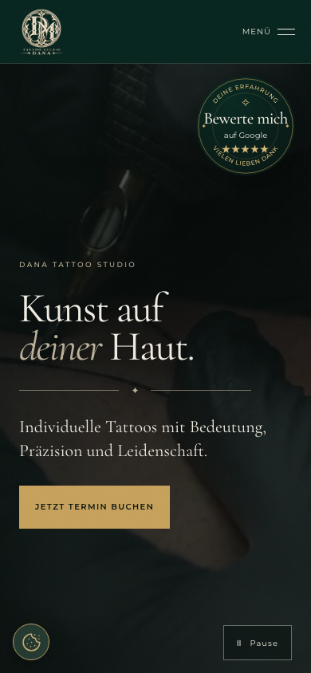

# Dana Tattoo Studio

Moderne und responsive Website für das **Dana Tattoo Studio** in Andernach.

🌐 **Live Website:** [tattoodana.de](https://tattoodana.de)

  
  &nbsp;
  

## Über das Projekt

Reales Kundenprojekt. Die Website präsentiert die Arbeiten und Leistungen des Studios und erleichtert Interessenten den Weg zur Terminanfrage über WhatsApp.

**Meine Rolle:** Konzeption, Design und vollständige Entwicklung.

## Funktionen

- Responsive Design für Desktop, Tablet und Smartphone
- Mehrseitige Navigation mit React Router
- Tattoo- und Piercing-Galerie
- Übersicht der Leistungen und Preise
- „Über mich“-Seite
- FAQ-Bereich
- Kontaktbereich mit WhatsApp-Integration
- Individuelles Design passend zur Studio-Identität

## Tech Stack

- **Frontend:** React, TypeScript, Vite
- **Styling:** SCSS Modules
- **Routing:** React Router
- **Backend / Daten:** Supabase
- **Code Quality:** ESLint, Prettier, Husky, lint-staged, Commitlint
- **CI:** GitHub Actions
- TypeScript im Strict-Modus

## Codequalität

- Einheitliche Formatierung mit Prettier
- Automatische Checks vor jedem Commit (Format, Lint, Test, Build)
- GitHub Actions bei Pushes und Pull Requests
- Keine Zugangsdaten im Repository – nur über Environment Variables

## Design

Dunkle Grüntöne kombiniert mit warmen goldenen Akzenten und eleganter Typografie.  
Ziel war eine hochwertige Atmosphäre, die zum Charakter des Tattoo-Studios passt.

**Schriftarten:** Cormorant Garamond + Montserrat

## Status

Fertig und veröffentlicht.
